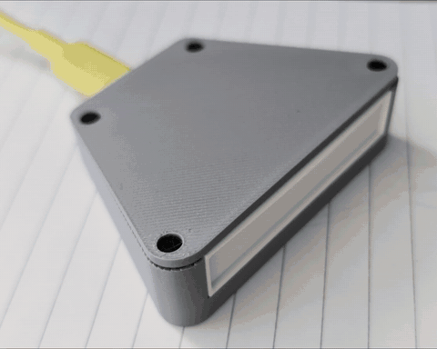
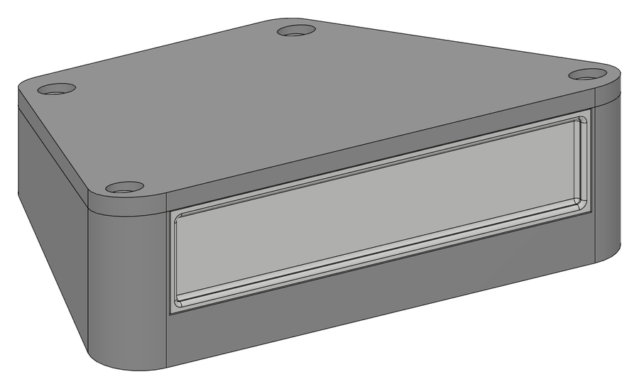
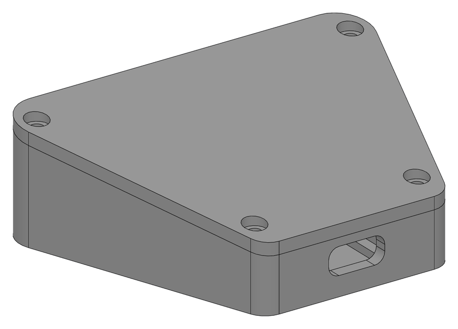
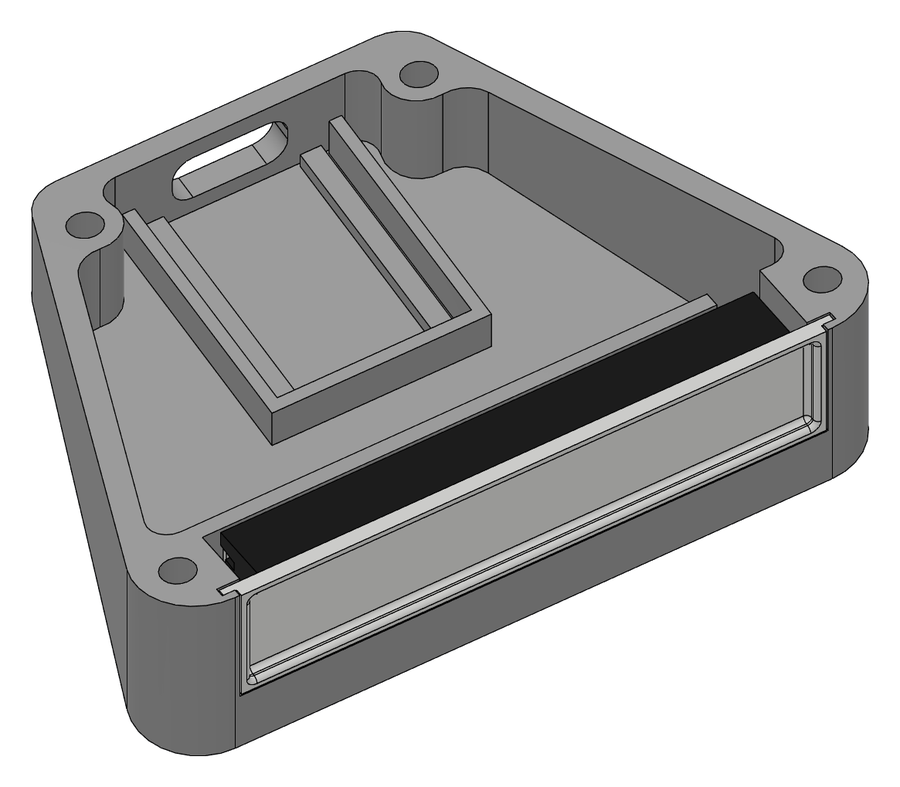
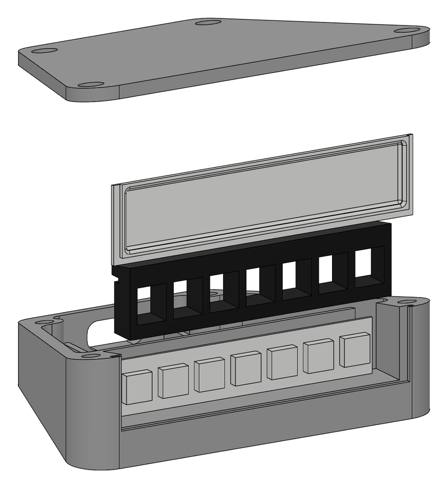

# Claude token LED

A desk LED (ESP32-C3 SuperMini Plus) that flashes live with the tokens Claude Code generates, and
signals when Claude waits for your approval. WiFi, battery-capable, no proxy.

It never calls the model and spends no tokens: it only watches output that is already flowing.



[Video (MP4)](media/TokenBlinker.mp4)

## Files

| File | What it is |
|---|---|
| `token_tap.cs` → `token_tap.exe` | **Live flashing:** launcher for the VS Code Claude extension. Passes the `claude.exe` output through unchanged and sends the token stream and approval waits to the LED. |
| `src/main.cpp` + `platformio.ini` | Firmware: onboard LED on GPIO8 (WS2812B or a plain LED), external strip, optional buzzer, WiFi + USB + web page. |
| `token_blinker.py` | WiFi setup over USB, colour test, and log-based counting for terminal Claude Code sessions. |
| `token_led.ino`, `token_led_test.py`, `token_proxy.py`, `claude-token-led.user.js` | Old proxy-based experiments (Hungarian comments), kept for reference. |

## How it works

```
VS Code Claude extension ──> token_tap.exe ──> claude.exe ──HTTPS──> api.anthropic.com   (unchanged)
                                  │  passes claude.exe's output through byte for byte,
                                  │  meanwhile counts from the stream_event lines
                                  └──UDP "T t 12" / "A 1"──> ESP32 (tokenled.local:4210) ──> flashes
```

There is no proxy and no background program, and the API traffic is untouched. If the LED is off or
there is no network, Claude works exactly the same, it just does not flash. The extension starts
`token_tap.exe` through the `claudeCode.claudeProcessWrapper` setting (VS Code user `settings.json`);
to switch it off, delete that line and start a new Claude session.

Text, thinking and tool-input tokens are estimated while generating (4 characters ≈ 1 token); at the end of
each message the real `output_tokens` tops up the difference. Thinking usually arrives redacted (no text, only
`estimated_tokens` progress in each `thinking_delta`, the same numbers the extension's token counter shows), so those are
counted instead. Input and cache tokens come exactly at the
start of the request.

| Colour | What | One flash (default) |
|---|---|---|
| cyan | text | 10 tokens |
| purple | thinking | 10 tokens |
| green | tool input | 10 tokens |
| orange | new input (`input` + `cache_creation`) | 100 tokens |
| dark blue | cache read | off |
| white, blinking | **Claude waits for your approval** | — |

Approval: when Claude asks permission for a tool (`control_request` / `can_use_tool` on its output),
the LED blinks white once per second until the request is answered. The LED forgets it after 5 s without a
refresh, so a crashed launcher cannot leave it blinking. With several Claude sessions open, answering one
clears the signal for all. The launcher also passes Claude's input through (byte for byte) and ends the signal the moment
your answer (`control_response`) goes in, so the LED stops blinking even while the approved tool is still running.

## Web page: http://tokenled.local

- **Virtual LEDs** (one column per type + approval) with live token counts and flash counts.
- Tokens per flash per type (0 = off), brightness, dim glow while Claude runs (off by default), power-saving WiFi
  (for battery; off = faster), colour test (including an approval blink), status, WiFi network change.
- **Onboard LED (GPIO8) and external strip are separate outputs.** The onboard LED can mirror everything (default),
  show only status and approval, or be off. The external strip has its own data pin (default **GPIO4**; allowed: GPIO 0-7 and 10)
  and any number of LEDs from 0 (none, default) to 65 535. Wire it with a shared GND and power it from its own 5 V supply;
  a strip draws up to ~60 mA per LED at full white, so lower the brightness. Drawing takes ~30 µs per LED, so flashes get
  slower with thousands of LEDs.
- **Colour per type.** Every type and the approval signal has its own colour picker (applies to the onboard LED and the strip).
- **LEDs per type (strip).** Each type can use any set of strip LEDs: a list like `1,3,5-8` (1 = first LED), `all` or `0` = every LED.
  Several types may share LEDs. Empty = automatic: with 5 or more LEDs every type gets its own LED (approval: the 6th LED when
  there are 6+), otherwise all strip LEDs flash together in the type's colour. Status dots and the glow go to the onboard LED
  (or to the strip's first LED when the onboard LED is off).

## WiFi setup (AP mode)

If no network is saved, or it cannot connect within 30 s, the LED starts its own open network
`TokenLED-xxxx` (last 4 digits of its MAC). Join it with a phone and the setup page opens by itself
(otherwise go to http://192.168.4.1): pick the network and enter the password. After a successful connection the AP
disappears. If the saved network is only temporarily unavailable, it retries every 3 minutes while nobody is on the AP.
The same over USB: `python token_blinker.py --wifi`.

A dim dot every 3 s: red = connecting to WiFi, yellow = setup AP running. At power-on: red-green-blue test.

## Usage

```powershell
pio run -t upload                 # firmware (COM9, platformio.ini)
python token_blinker.py --wifi    # WiFi over USB instead of AP mode: asks for name and password, saved in the ESP's flash
python token_blinker.py --test 3  # colour test (WiFi); --usb for the USB serial port
C:\Windows\Microsoft.NET\Framework64\v4.0.30319\csc.exe /nologo /optimize /r:System.Web.Extensions.dll token_tap.cs
```

`--wifi` and `--usb` need `pip install pyserial`; the WiFi mode uses the standard library only. The PlatformIO serial
monitor and the script cannot hold the port at the same time.

Rebuilding `token_tap.exe` fails while a Claude session uses it (file lock). Rename the running exe first
(`ren token_tap.exe token_tap_old.exe`; running processes keep working), then build. If the project folder moves, also change
the path in the VS Code setting, otherwise Claude will not start.

Terminal Claude Code: `python token_blinker.py` (from the logs, per response; it skips VS Code sessions so nothing is
counted twice). Approval waits are only detected in VS Code.

On battery: modem sleep and 80 MHz CPU for lower power (a few hundred ms latency). The board has no charger; power
goes to the 3.3–6 V VCC/5V pin; the WS2812B draws about 1 mA even when off.

Protocol (UDP 4210 and USB CDC, one command per line, several lines per UDP packet are fine):
`T <t|k|j|i|r> <tokens>` raw tokens, `B <type> <count>` flash directly, `A 1` / `A 0` approval wait, `P` keep-alive;
USB only: `W <ssid>\t<password>`, `?` → `IP <address>` / `NOWIFI`.

## More features

- **Web pages:** *Live* (virtual LEDs, click one to test it, usage bars with the time each limit resets, 7-day totals, status), *Settings* (all options) and
  *System* (WiFi, firmware update over WiFi: upload `.pio/build/supermini/firmware.bin`; the page has no password).
- **Finished / error signal:** at the end of a turn the LED shows solid green (finished) or blinking red (error).
- **Approval has priority:** while Claude waits for approval, queued flashes are dropped and only the white blink runs.
- **Usage bar:** the strip shows the 5-hour or weekly limit (from Claude's `rate_limit_event`) as a dim green/yellow/red bar.
- **History:** optional running light, every flash enters at LED 1 and slides along the strip.
- **Night:** dim (or switch off) between two hours; time via NTP, time zone as a POSIX string.
- **7-day totals** are kept in flash (output / new input / cache per day).
- **MQTT / Home Assistant** (optional, runs in its own task, a missing broker never delays the LED): `prefix/state`
  (idle, working, approval, done, error), `prefix/usage5`, `prefix/usage7`, plus MQTT discovery.
- Flashes are fast (~50 ms per flash, faster with a backlog) and the backlog is capped at ~1 s, so the LED stays live.
  Switch off *Power-saving WiFi* on the Settings page for the lowest latency (needs mains/USB power).

- **Approval reminder:** after N seconds of pending approval (default 45, 0 = off) the white blink gets twice as fast.
- **Last 24 hours:** bar chart on the Live page (output + new input per hour) with the busiest hour; kept in flash.
- **BOOT button (GPIO9):** short press = quiet mode (night brightness) until pressed again, long press (1.5 s) = reset the live counters.
- **Backup:** System page → download the settings as JSON (`/config.json`, no WiFi or MQTT password) and restore them from a file.

- **30-day chart** on the Live page (output + new input per day, 7-day table kept); the older 7-day data is carried over.
- **Recent events** on the Live page (updates live): started working, approval asked/answered, finished/error, usage reaching 60/85/100 %.
- **Settings in collapsible sections** (flashes, LEDs and colours, strip display, night and time, MQTT); the browser remembers which are open.

- **Onboard LED section** (Settings): mode (mirror / status + approval only / off), its own brightness, which functions it mirrors
  (per type and approval), finished/error signal on or off, and an idle colour that follows the 5-hour usage.
- The **System** page is sectioned too (WiFi, firmware update, backup, device).

- **Onboard LED type** (Settings > Onboard LED): RGB WS2812B (default), or a plain LED lit on LOW (like the blue LED of the
  plain SuperMini) or on HIGH. A plain LED cannot show colours, so it shows every colour as a brightness (PWM).
  The onboard brightness percentage now also applies right after power-on.
- **Buzzer** (Settings > Buzzer, off by default): an active or passive buzzer on its own GPIO (0-7 or 10, not the strip's pin;
  a passive one gets a tone, 2700 Hz by default). Approval wait: silent, one beep (one more when the reminder starts), or a beep
  every second in step with the white blink until answered. Optionally a short click with every flash. Silent at night and in
  quiet mode. Use a buzzer module with a transistor, or keep a bare buzzer under ~20 mA. Test: click the approval LED on the Live page.

New protocol lines: `D 0` / `D 1` (turn finished / error), `U <5h%> <7d%> [<5h reset> <7d reset>]` (usage, -1 = unknown;
optional reset times as Unix time, 0 = unknown).

## Enclosure (3D print, Fusion 360)

| Front | Back (USB-C) |
|---|---|
|  |  |
| **Without the lid** | **Exploded** |
|  |  |

`enclosure/TokenLED_Box/TokenLED_Box.py` is a Fusion 360 script that builds the box (concept "A", parametric: change the numbers
at the top and run it again). Fusion 360 > Utilities > Scripts and Add-Ins > Scripts > "+" > pick the `TokenLED_Box` folder > Run.
It creates the bodies *Base*, *Lid*, *Diffuser* and *Baffle* (plus *Strip (reference)*, only to show the LED strip) and saves
`base.stl`, `lid.stl`, `diffuser.stl` and `baffle.stl` next to the script.
`python enclosure/plate_p2s.py` turns them into print orientation (`*_P2S.stl`) and one plate file per filament colour:
`TokenLED_Box_P2S.3mf` (base + lid), `TokenLED_Diffuser_P2S.3mf` (white) and `TokenLED_Baffle_P2S.3mf` (black).

`TokenLED_Box.f3d` is the Fusion design with hand edits on top of the script's output (Fusion 360 > File > Open > Open from my
computer). The STL and 3MF files come from this design; the script still builds the version without the edits:
- Diffuser: the light window is recessed 1.2 mm from the front with rounded edges, so it is only 0.4 mm thick in front of the
  LEDs (brighter, less diffusion).
- Baffle: the bar below each cell fills the space under the LED up to its lower edge; the walls are cut back at the strip's upper
  edge; the left end wall reaches back like the inner walls, the right one stops short for the wires.
- Base: rounded inner corners at the front.

- Wedge with a trapezoid footprint: 74 mm wide at the front (68.8 mm across the rounded front corners), 36 at the back,
  52 deep; 22 mm high at the front, 13 at the back.
- Front: the 7-LED strip (50 x 9.84 mm) stands on its edge in a bay behind the front, its back stuck to the bay's back wall,
  with 2 mm of free room at each end. The wires go back through a slot at the right end of that wall (open at the top, so
  they are laid in, not threaded).
- Light baffle (**black PLA**): one 5.67 x 8 mm cell per LED, so each LED lights only its own segment of the diffuser. Its
  1.38 mm walls reach into the 2.08 mm gaps between the LEDs (0.35 mm play on each side), which also centres it; its top bar
  holds the strip down. It has 1.6 mm of room at each end of the bay, so stick the strip roughly in the middle.
- Diffuser (**white PLA**, 1.6 mm): it slides down from the top, flush with the front face; its back plate reaches behind
  0.8 mm lips at the sides and the bottom, so it cannot fall out forwards, and the lid holds it down.
- Back: the ESP32-C3 SuperMini Plus on two rails between fences, its USB-C end in the rear opening (11 x 5.2 mm).
- Lid: sloped plate, 4 x **M2 x 5** screws into **M2 brass heat-set inserts** (3.2 mm holes, 4 mm deep; press them in with a
  soldering iron). The screw posts are joined to the corners.
- 4 round recesses (10 mm, 1 mm deep) in the bottom for adhesive rubber feet.
- Assembly: board, strip (wires into the slot), baffle, diffuser, lid. The baffle's lower bar reaches under the LEDs, so it
  cannot be lowered straight in front of the stuck strip: lower it about 1.2 mm further forward (into the empty diffuser slot),
  then push it back so the bar slides under the LEDs.
- Printing (Bambu Lab P2S, PLA Basic, 0.2 mm Standard, 3 walls, 15 % infill, no supports): the base stands on its bottom,
  the lid lies on its top face, the diffuser on its back plate, the baffle on its front face.
- The LEDs are measured (4.97 x 4.96 mm, 2.08 mm gaps, strip 9.84 mm wide). Still assumed: board 23 x 18 mm; strip 50 mm
  long and 0.5 mm thick with its tape, LEDs 1.6 mm tall and centred on the strip. Measure yours and adjust the parameters.
